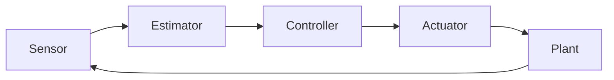

# Writing notes

Each note is a Markdown file in `docs/notes/`. To add one:

1. Create a file, e.g. `docs/notes/control/pid-tuning.md`.
2. Add it to the `Notes` section of `nav` in `zensical.toml`.
3. Optionally add a `date:` to its front matter so it appears under
   *Recent notes* on the home page.

```yaml
---
date: 2026-11-01
description: One-line summary.
---
```

## Math

Inline math uses `\( ... \)` or `$...$`: \(e^{i\pi} + 1 = 0\). Display math
uses `$$ ... $$`:

$$
\mathbf{M}(\mathbf{q})\ddot{\mathbf{q}} + \mathbf{C}(\mathbf{q}, \dot{\mathbf{q}})\dot{\mathbf{q}} + \mathbf{g}(\mathbf{q}) = \boldsymbol{\tau}
$$

## Code

```cpp title="pid.hpp"
struct Pid {
  double kp, ki, kd, integral = 0.0, prev = 0.0;
  double update(double error, double dt) {
    integral += error * dt;
    double d = (error - prev) / dt;
    prev = error;
    return kp * error + ki * integral + kd * d;
  }
};
```

Inline code with highlighting: `#!python np.linalg.solve(A, b)`.

## Admonitions

!!! note
    Use `!!! note`, `!!! tip`, `!!! warning`, and so on.

??? info "Collapsible"
    Use `???` instead of `!!!` for a block that starts collapsed.

## Links, footnotes, and tables

Link to other notes with relative paths:
[ODE integrators](../simulation/ode-integrators.md). Footnotes work too.[^1]

| Key          | Action  |
| ------------ | ------- |
| ++ctrl+k++   | Search  |

[^1]: Footnotes appear at the bottom of the page.

## Diagrams


