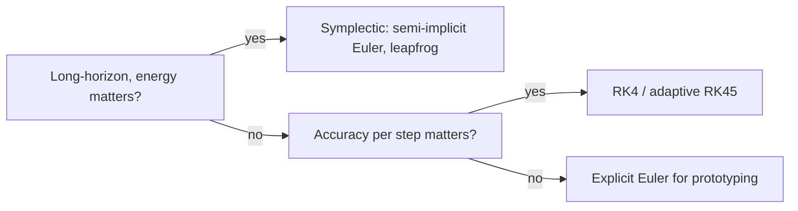

# ODE integrators for mechanical systems

Most simulators advance a state \(\mathbf{x}\) with
\(\dot{\mathbf{x}} = f(\mathbf{x}, t)\) using a fixed step \(h\). The choice
of integrator matters most for oscillatory systems, where some methods add
or remove energy.

## Test problem

The undamped harmonic oscillator \(\ddot{x} = -\omega^2 x\) conserves the
energy \(E = \tfrac{1}{2}\dot{x}^2 + \tfrac{1}{2}\omega^2 x^2\), which makes
the error of each method easy to see.

## Methods

=== "Explicit Euler"

    $$
    x_{n+1} = x_n + h\, v_n, \qquad v_{n+1} = v_n - h\,\omega^2 x_n
    $$

    First order. The energy grows by a factor \(1 + h^2\omega^2\) every step,
    so the oscillation spirals outward.

=== "Semi-implicit Euler"

    $$
    v_{n+1} = v_n - h\,\omega^2 x_n, \qquad x_{n+1} = x_n + h\, v_{n+1}
    $$

    Also first order, but symplectic: the energy error stays bounded, which is
    why many physics engines use it.

=== "RK4"

    Fourth order. It evaluates \(f\) four times per step and is very accurate
    for small \(h\), but it is not symplectic, so energy slowly drifts over
    long runs.

## Implementation

```python linenums="1"
import numpy as np

def step_semi_implicit(x, v, h, omega):
    v = v - h * omega**2 * x
    x = x + h * v
    return x, v

def energy(x, v, omega):
    return 0.5 * v**2 + 0.5 * omega**2 * x**2

x, v, h, omega = 1.0, 0.0, 0.01, 2 * np.pi
for _ in range(10_000):
    x, v = step_semi_implicit(x, v, h, omega)
print(energy(x, v, omega))  # stays close to the initial value
```

## Choosing a method



Related: [Rotation representations](../dynamics/rotation-representations.md).
